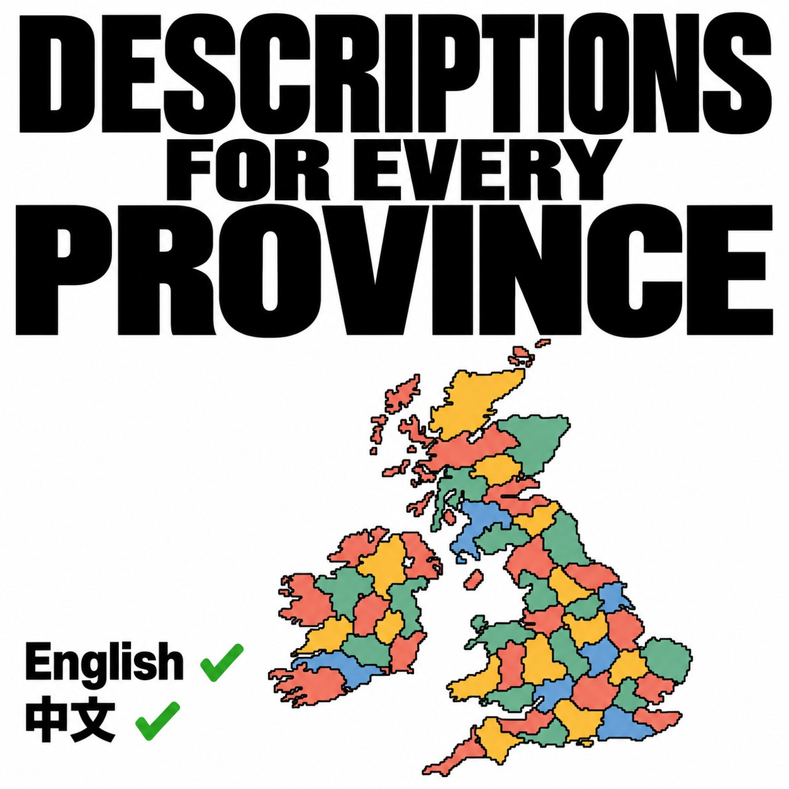

# Descriptions for Every Province / 所有省份的描述

**[English](#english) · [简体中文](#简体中文)**

## English

An EU4 mod with English and Simplified Chinese descriptions for all 3,272 land provinces: what the place is, how it stood in 1444, and the people and events that shaped it up to 1821.

### Getting started

Subscribe on the [Steam Workshop](https://steamcommunity.com/sharedfiles/filedetails/?id=3833082096) and enable the mod in the launcher. Click a province and hover the scroll button next to the terrain picture. For uncolonized provinces the button is at the right end of the picture.

Prefer not to use the Workshop? Download the ZIP from [Releases](https://github.com/wangyufeng0615/eu4-province-descriptions/releases/latest):

1. Download `province_descriptions-<version>.zip`.
2. Extract it into `Documents\Paradox Interactive\Europa Universalis IV\mod\`, so that the `province_descriptions` folder and `province_descriptions.mod` sit side by side.
3. Enable **Descriptions for Every Province** in the launcher.

Use either the Workshop copy or the ZIP copy, not both. To update, delete the old folder and extract the new ZIP. See the [changelog](CHANGELOG.md) for what changed.

### Language

The text follows the [Chinese Language Mod for 1.37](https://steamcommunity.com/sharedfiles/filedetails/?id=2976470733): with it enabled you get Chinese, otherwise English. Other Chinese translation mods are not detected.

### Compatibility

Made for EU4 1.37. It only adds description text, so it works with existing saves, and it works with or without Bigger UI. It is not achievement compatible: the scripted button changes the game checksum.

### About the text

The descriptions were written with AI assistance from published sources, mostly Wikipedia in the local language, and corrected over several passes. Per-province sources ship with the mod in `sources/sources.jsonl`. Corrections are welcome in the Workshop comments or as GitHub issues; include the province name.

### Source and build

The descriptions are written and checked in a separate research repository and exported into `data/`; don't edit `data/` by hand. Building needs Python 3.10 or newer and nothing else:

    python -B tools/build.py --check
    python -B -m unittest discover -s tests -v
    python -B tools/build.py --output dist/my-build

Use a new output directory for each build. The result is the mod folder, a ZIP and a checksum receipt. Pushing a tag `vX.Y.Z` builds that commit on GitHub Actions and attaches the ZIP to a release.

### Credits and reuse

Descriptions and translations are **CC BY-SA 4.0**; tools are **MIT**. See [LICENSE](LICENSE) and [CREDITS.md](CREDITS.md). The cover is an AI-assisted graphic and is not covered by either licence. `assets/vanilla/` holds the vanilla province window definitions the mod extends; they belong to Paradox. This is an unofficial community project, with no affiliation to Paradox, Valve or Wikimedia.

## 简体中文

《欧陆风云4》模组，为全部 3,272 个陆地省份提供英文和简体中文介绍：这里是什么地方，1444 年是什么样子，到 1821 年出过哪些人物、发生过哪些大事。

### 怎么使用

在 [Steam 创意工坊](https://steamcommunity.com/sharedfiles/filedetails/?id=3833082096)订阅，在启动器里启用。点开省份，鼠标停在风景图旁的卷轴按钮上；未殖民省份的按钮在风景图内靠右。

不想用创意工坊，也可以从 [Releases](https://github.com/wangyufeng0615/eu4-province-descriptions/releases/latest) 下载 ZIP：

1. 下载 `province_descriptions-<版本号>.zip`。
2. 解压到 `文档\Paradox Interactive\Europa Universalis IV\mod\`，让 `province_descriptions` 文件夹和 `province_descriptions.mod` 并排。
3. 在启动器里启用 **Descriptions for Every Province**。

创意工坊版和 ZIP 版二选一，不要同时启用。更新时删掉旧文件夹，再解压新的 ZIP。每次的改动见[更新记录](CHANGELOG.md)。

### 语言

需要同时启用 [Chinese Language Mod for 1.37](https://steamcommunity.com/sharedfiles/filedetails/?id=2976470733) 才显示中文，否则显示英文；其他汉化模组识别不到。

### 兼容性

适配 EU4 1.37。只增加介绍文本，已有存档可以直接用，装不装 Bigger UI 都能用。不兼容成就：脚本按钮会改变游戏校验码。

### 内容是怎么写的

介绍由 AI 辅助、依据公开资料（以当地语言的维基百科为主）写成，并反复订正。每个省份的资料来源随模组附在 `sources/sources.jsonl`。发现错误欢迎在工坊留言或提 GitHub issue，请带上省份名称。

### 源码与构建

正文在单独的研究仓库里撰写和核对，再导出到 `data/`，不要手改 `data/`。构建只需要 Python 3.10 以上，不需要游戏或其他依赖，命令见英文部分。每次构建用新的输出目录，产物是模组文件夹、ZIP 和哈希回执。推送 `vX.Y.Z` 标签后，GitHub Actions 从该提交构建，并把 ZIP 附到 Release。

### 来源与许可

介绍和翻译采用 **CC BY-SA 4.0**，工具采用 **MIT**，见 [LICENSE](LICENSE) 和 [CREDITS.md](CREDITS.md)。封面是 AI 辅助生成的图形，不在这两个许可范围内。`assets/vanilla/` 里是模组所扩展的原版省份窗口定义，归 Paradox 所有。本项目为非官方社区模组，与 Paradox、Valve、Wikimedia 没有关联。
